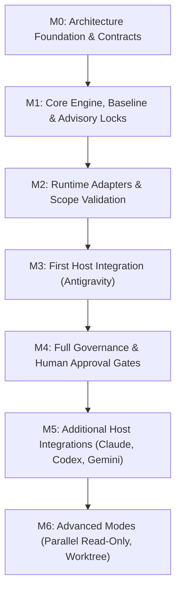

# genai-agentic-ops Target Architecture

## 1. Vision & Core Philosophy

`genai-agentic-ops` is a reusable, host-native, multi-agent coding orchestration system built on top of the established Agentic Ops governance framework.

### Core Architectural Principles
1. **Host-Native, Not Orchestrator-First**: The developer interacts directly with their preferred host coding assistant (Antigravity, Claude Code, Codex, Gemini CLI). The orchestrator does not provide a competing chat interface; it operates as a deterministic CLI, state engine, and coordination protocol invoked by the host.
2. **Deterministic Governance**: State transitions, path ownership, safety checks, and policy enforcement are strictly deterministic and machine-validated. Model reasoning is untrusted and never treated as self-authenticating authority.
3. **Project-Scoped & Shared Workspace**: Configuration and orchestration state are contained entirely within the target repository (`.agentic/`). Workers operate sequentially within the shared repository workspace under strict baseline snapshots and diff validation.
4. **Decoupled Roles**: The host acts as the conversational interface and default planner; external planners may be dynamically selected; workers execute assigned scopes; governance independently verifies outputs.

---

## 2. Five-Layer System Architecture

```text
+------------------------------------------------------------------------+
| 1. Host Integrations (Host Assistants)                                 |
|    - Antigravity Workflows/Skills      - Claude Code Tools/Hooks        |
|    - Codex Skills                      - Gemini CLI Commands           |
+------------------------------------------------------------------------+
                                   | (CLI Protocol / JSON Envelope)
                                   v
+------------------------------------------------------------------------+
| 2. Orchestration Core                                                  |
|    - Coordinator (Lifecycle)           - Task Manager (Registry/CRUD)   |
|    - State Machine (Transitions)       - Workflow Engine (DAG/Deps)    |
|    - Planner Resolver (Dynamic Mode)   - Context & Handoff Builder     |
+------------------------------------------------------------------------+
                  |                                        |
                  v                                        v
+------------------------------------+  +--------------------------------+
| 3. Runtime Adapters                |  | 4. Governance & Policy Engine  |
|    - Antigravity CLI (agy)         |  |    - Policy Engine (kit/core)  |
|    - Claude Code CLI (claude)      |  |    - Workspace Baseline Snap   |
|    - Codex CLI (codex)             |  |    - File Ownership & Locks    |
|    - Gemini CLI (gemini)           |  |    - Path Scope Validator      |
|    (Levels: documented, fixture,   |  |    - Independent Verifier      |
|     live-tested)                   |  |    - Human Approval Gates      |
+------------------------------------+  +--------------------------------+
                  \                                        /
                   +-------------------+------------------+
                                       |
                                       v
+------------------------------------------------------------------------+
| 5. Storage & Artifacts (Project-Local Filesystem)                      |
|    - Config (`agentic.yaml`)           - Locks (`.agentic/locks/`)     |
|    - Plans (`.agentic/plans/`)         - State DB/JSON (`.agentic/state`)|
|    - Runs & Intents (`.agentic/runs/`) - Projections (`CURRENT_OPS.md`)|
+------------------------------------------------------------------------+
```

---

## 3. Component Responsibilities & Boundaries

| Component | Primary Responsibility | Strict Negative Boundary (Must NOT Do) |
|---|---|---|
| **Host Integration** | Surface skills, commands, and hooks to user assistant | Execute unverified plans or bypass orchestrator CLI |
| **Coordinator** | Orchestrate lifecycle events across engine and adapters | Call LLM APIs directly or implement provider-specific logic |
| **State Machine** | Enforce valid state transitions with actor permissions | Make subjective or probabilistic LLM evaluations |
| **Task Manager** | Register, update, query, and persist task objects | Spawn worker processes or execute commands directly |
| **Workflow Engine**| Resolve dependency graphs and select ready tasks | Bypass governance checks or allow unapproved runs |
| **Planner Resolver**| Resolve `host` alias or invoke selected external planner | Silently fall back or substitute failed planners |
| **Runtime Adapters**| Detect CLIs, invoke headless processes, normalize output| Enforce workflow policy or decide task approvals |
| **Context Builder**| Assemble bounded, minimal handoff packets for workers | Leak unbounded conversation history or hidden thoughts |
| **Governance Engine**| Verify path bounds, run tests, enforce human approvals | Trust self-reported success or claims from workers |
| **Storage Layer** | Provide atomic persistence and crash recovery logs | Contain workflow orchestration or business logic |

---

## 4. Single Source of Truth & Operational Projections

To prevent drift between machine state and human-readable tracking:
- **Canonical State**: The project-local filesystem store (`.agentic/state/` and `.agentic/runs/`) is the single authoritative source of truth for all workflows, tasks, locks, and verification records.
- **One-Way Projection**: `docs/CURRENT_OPS.md` is strictly an emitted projection generated from `.agentic/state/`. Agents and CLI commands update `.agentic/state`, which automatically renders the active rows into `CURRENT_OPS.md`. Manual edits to `CURRENT_OPS.md` never override canonical state.

---

## 5. Revised Milestone Roadmap

Addressing architectural feedback, critical governance controls (baseline snapshots, advisory locks, and path scope checks) are pulled into M1 and M2 before the M3 host release.



### Milestone Definitions
- **M0 — Architecture Foundation & Contracts (Current)**:
  System architecture, threat model, state machine specifications, ADRs (001-008), versioned JSON Schemas, and contract validation tests.
- **M1 — Orchestration Core, Workspace Baseline & Advisory Locks**:
  Task/workflow management, dependency resolution, atomic filesystem persistence, crash-resilient write-ahead intent logging, pre-execution workspace baseline snapshotting (hashes of tracked and untracked/gitignored files), and process-verified advisory locking.
- **M2 — Runtime Adapters & Scope Validation**:
  Adapter interface with typed execution results (`exit_code`, `timed_out`, `permission_denials`), process tree termination, post-execution diff capture, path scope validation against `allowed_paths` and built-in protected paths, and adapter contract fixtures.
- **M3 — First Host Integration (Antigravity)**:
  Antigravity workflow integration, host planner submission protocol, plan validation against JSON Schema, worker delegation, and round-trip status reporting.
- **M4 — Governance Integration & Human Approval Gates**:
  Direct integration with `kit/core/policy.py`, out-of-band interactive human approval gates, independent verification execution against an allow-list of verification commands, and automated projection to `CURRENT_OPS.md`.
- **M5 — Additional Host Integrations**:
  Claude Code, Codex, and Gemini CLI host integrations sharing the identical orchestration CLI protocol and schemas.
- **M6 — Advanced Capabilities**:
  Parallel read-only task execution, optional git worktree isolation, Project Readiness Score, and autonomous harness suggestions.
