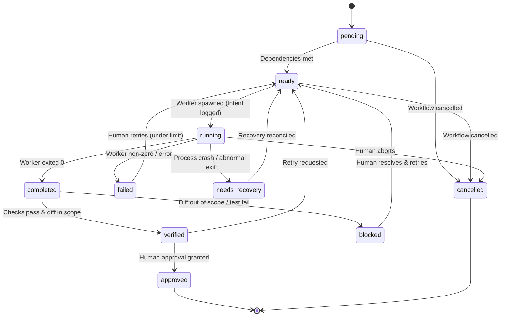
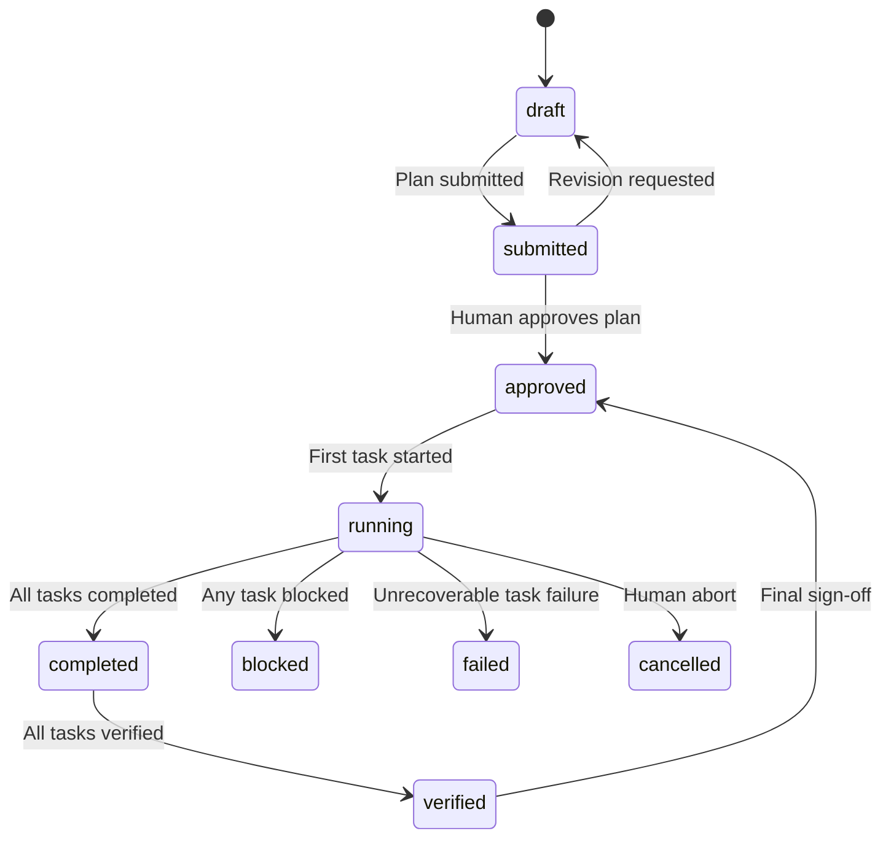

# State Machine & Lifecycle Transitions

## 1. Overview

`genai-agentic-ops` models workflow execution as deterministic, auditable state machines. State transitions are strictly validated against actor permissions to ensure that untrusted worker models cannot self-certify completion or bypass governance gates.

---

## 2. Task Lifecycle State Machine



### 2.1 Task State Definitions
- `pending`: Task registered in plan; waiting for upstream dependencies to complete.
- `ready`: All dependencies satisfied; eligible for worker execution.
- `running`: Worker runtime spawned and actively executing in shared workspace.
- `completed`: Worker process exited successfully (exit code 0); awaiting independent verification.
- `verified`: Independent test suite passed and workspace diff is verified strictly within `allowed_paths`.
- `approved`: Human operator explicitly approved the task execution and changes.
- `blocked`: Execution produced out-of-scope diffs, permission violations, or policy conflicts.
- `failed`: Worker process exited with non-zero status or exceeded execution timeout.
- `cancelled`: Task aborted by user or parent workflow cancellation.
- `needs_recovery`: Orchestrator detected orphaned intent or unexpected process termination.

---

## 3. Transition Matrix & Actor Permissions

Every state transition must be initiated by an authorized actor and satisfy preconditions.

| Current State | Target State | Permitted Actor | Trigger / Event | Preconditions & Side Effects |
|---|---|---|---|---|
| `pending` | `ready` | Orchestrator Engine | `DEPENDENCIES_RESOLVED` | All `depends_on` tasks are in `approved` (or `verified` if auto-approved). |
| `ready` | `running` | Orchestrator Core | `SPAWN_WORKER` | Write-ahead intent logged; advisory lock acquired; workspace baseline hashed. |
| `running` | `completed` | Worker Adapter | `PROCESS_EXIT_ZERO` | Worker process exited with code 0; raw execution output recorded. |
| `running` | `failed` | Worker Adapter | `PROCESS_ERROR` | Non-zero exit code or timeout exceeded; error recorded. |
| `running` | `needs_recovery` | Orchestrator Recovery | `ORPHAN_DETECTED` | Worker process missing without recorded exit; staleness check triggered. |
| `completed` | `verified` | Governance Engine | `VERIFICATION_PASS` | Workspace diff is strictly within `allowed_paths`; verification commands pass. |
| `completed` | `blocked` | Governance Engine | `POLICY_VIOLATION` | Workspace diff contains out-of-scope files or verification command failed. |
| `verified` | `approved` | Human Operator | `GRANT_APPROVAL` | Interactive human confirmation received. Lock released. |
| `blocked` | `ready` | Human Operator | `RESOLVE_BLOCKER` | Human inspected diff, resolved conflict, and authorized re-run. |
| `failed` | `ready` | Orchestrator / Human | `RETRY_TASK` | Retry counter < `retry_limit` and retry approved. |
| `*` | `cancelled` | Human Operator | `USER_ABORT` | Process group killed; locks released; workspace preserved for review. |

> [!IMPORTANT]
> Workers are strictly limited to reporting process completion (`running` -> `completed` or `failed`). A worker can NEVER transition a task to `verified` or `approved`.

---

## 4. Workflow Lifecycle



- `draft`: Plan being assembled by host or external planner.
- `submitted`: Plan submitted to orchestrator; validated against `plan.schema.json`.
- `approved`: Human reviewed and accepted the workflow plan.
- `running`: One or more tasks executing sequentially.
- `completed` / `verified`: All tasks reached completion/verification.

---

## 5. Write-Ahead Intent Logging & Crash Recovery

To prevent partial state transitions or corrupt recovery after crashes:

```text
1. WRITE INTENT ---> 2. ACQUIRE LOCK ---> 3. SPAWN WORKER ---> 4. WRITE RESULT ---> 5. RELEASE LOCK
   (.agentic/runs/      (.agentic/locks/     (CLI Process)       (.agentic/runs/       (Release)
    intent-<id>.json)    lock.json)                               result-<id>.json)
```

1. **Write-Ahead Intent**: Before spawning any worker or mutating workspace files, the orchestrator writes an `intent.json` record containing:
   - Target task and workflow ID
   - Intended state transition (`ready` -> `running`)
   - Host PID, hostname, and timestamp
   - Baseline workspace snapshot hash
2. **Execution**: The worker process is launched.
3. **Result Commit**: Upon process termination, a matching `result.json` record is written atomically (`.tmp` + rename).
4. **Crash Reconciliation**:
   - On startup, the orchestrator scans `.agentic/runs/` for unmatched `intent.json` files.
   - If an intent exists without a result, the orchestrator queries the operating system for the recorded `(host, pid, process_start_time)` tuple.
   - If the process is dead, the task transitions to `needs_recovery`, preserving the baseline snapshot and existing workspace diff for human review.
