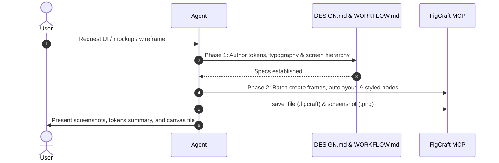

# FigCraft UI Design Playbook

Standard operating playbook for recommending, specifying, and orchestrating FigCraft MCP canvas rendering for UI designs, wireframes, app mockups, and interactive prototypes.

## 1. When to Activate

Trigger this skill immediately when:
- The user requests UI/UX mockups, wireframes, app screen layouts, or visual prototypes (e.g. "bikin UI", "desain app", "mockup", "wireframe", "tampilan antarmuka").
- An existing project requires visual interface specifications before frontend code implementation.
- The user invokes the `/figcraft` command.

## 2. Recommendation Flow

When the user requests UI design without specifying a tool:
1. Recommend using **FigCraft** via `/figcraft`.
2. Explain the structured two-phase process: creating explicit design tokens (`DESIGN.md`) and screen wireframes (`WORKFLOW.md`), followed by programmatic canvas rendering via FigCraft MCP.
3. Confirm whether the user wants a mobile, tablet, or desktop viewport and any specific branding/color preferences.

## 3. Playbook: Two-Phase Execution

### Phase 1: Design Specifications ("Otak Desain")

Create specification files under `projects/<app-name>/`:

1. **`DESIGN.md`**:
   - **Pillars & Style**: Clean, modern, high-contrast, or platform-native (iOS HIG / Material 3).
   - **Color System**: HEX values for `background`, `surface`, `primary`, `secondary`, `text-primary`, `text-muted`, `border`, `accent`, and semantic status (`success`, `warning`, `danger`).
   - **Typography**: Hierarchy with font families, font sizes (px), font weights, line heights, and letter spacing.
   - **Spacing & Radii**: Base 4px/8px scale (e.g. 4, 8, 12, 16, 24, 32px) and border radius tokens (sm, md, lg, full).
   - **Ergonomics & Accessibility**: Touch target min sizes ($\ge 44 \times 44\,\text{px}$), contrast ratios ($\ge 4.5:1$ for normal text).

2. **`WORKFLOW.md`**:
   - Screen inventory (e.g. Onboarding, Dashboard, Profile, Settings).
   - Wireframe layout breakdown for each screen.
   - Tree representation of FigCraft nodes (Frames, Stacks, Rectangles, Text, Vectors).

### Phase 2: FigCraft MCP Canvas Rendering

Execute canvas operations using the FigCraft MCP server:

1. **Check Environment**:
   - Verify MCP status: `powershell -NoProfile -File scripts/figcraft.ps1 -Action status`.
   - Ensure binary is available and GUI is attached if live inspection is desired (`--attach 8089`).

2. **Construct Canvas Nodes**:
   - Use `create_node` or `batch` for atomic operations.
   - Establish parent artboards (e.g. Frame with width $393$, height $852$ for mobile, or $1440 \times 900$ for desktop).
   - Apply layout properties with `set_properties` (AutoLayout direction `HORIZONTAL` or `VERTICAL`, padding, spacing, alignment).
   - Insert UI controls: buttons, input fields, navigation bars, cards, modal sheets.

3. **Persist and Deliver Artifacts**:
   - Call `save_file` to save `projects/<app-name>/<app-name>.figcraft`.
   - Call `screenshot` to generate PNG visual renders.
   - Provide user with image previews and clear links to the generated `.figcraft` document and markdown specifications.

## 4. Quality Checklist

- [ ] Has `DESIGN.md` established all foundational tokens before node creation?
- [ ] Are AutoLayout containers used instead of arbitrary manual pixel placements?
- [ ] Do text contrast ratios meet WCAG AA standards?
- [ ] Is the `.figcraft` file saved in `projects/<app-name>/`?
- [ ] Are screenshots exported and embedded or referenced for user review?
