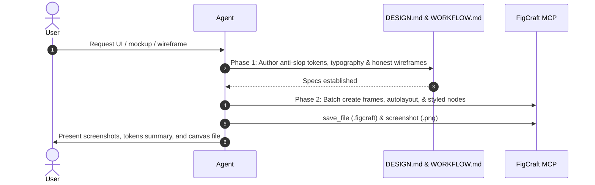

# FigCraft UI Design Playbook: Anti-AI Slop & Honest UI

Standard operating playbook for recommending, specifying, and orchestrating FigCraft MCP canvas rendering for human-crafted, distinctive UI designs, wireframes, app mockups, and interactive prototypes.

## 1. When to Activate

Trigger this skill immediately when:
- The user requests UI/UX mockups, wireframes, app screen layouts, or visual prototypes (e.g. "bikin UI", "desain app", "mockup", "wireframe", "tampilan antarmuka").
- An existing project requires visual interface specifications before frontend code implementation.
- The user invokes the `/figcraft` command.

## 2. Recommendation Flow

When the user requests UI design without specifying a tool:
1. Recommend using **FigCraft** via `/figcraft`.
2. Explain the structured two-phase process: creating explicit design tokens (`DESIGN.md`) and screen wireframes (`WORKFLOW.md`), followed by programmatic canvas rendering via FigCraft MCP.
3. Confirm whether the user wants a mobile, tablet, or desktop viewport and any specific branding/color preferences.

## 3. Anti-AI Slop Standards (Mandatory Invariants)

Generative AI and unguided LLMs default to statistical averages: generic templates, dark glassmorphism, and centered SaaS hero sections. Agents MUST enforce these negative and positive design constraints:

### 3.1 Banned AI Slop Tropes (Never Use)
- ❌ **The "Lazy-Cool" Palette**: No electric purple-to-indigo/cyan gradient glows, no glowing background orbs/blobs with no light source, no cheap glassmorphism blurs.
- ❌ **The Cliché Hero Section**: No centered hero with a badge pill (`✨ Introducing...` / `AI-Powered`), oversized bold title, 2-line gray subtitle, and two identical buttons.
- ❌ **Uniform Card Factories**: No repeated rows of identical 3-column cards with uniform rounded corners, drop-shadow crutches, and a decorative icon floating over a title.
- ❌ **Decorative Fluff Overload**: No icons next to every single list item, no arbitrary emojis as bullets, no empty buzzwords (*"supercharge your workflow"*, *"seamlessly unlock"*).
- ❌ **Typography Monotony**: Never default to `Inter` without deliberate rationale.

### 3.2 Human Craft & Honest UI Principles
- **Authorial Intent (1 Emotional Adjective)**: Commit to a distinct point of view (e.g. *clinical, tactile, earthy, utilitarian, brutalist, editorial, playful*).
- **Typography Does the Heavy Lifting**: Pair a high-character display face (bold serif, geometric grotesque, monospace) with a readable body face. Use bold optical contrast (`clamp()` large display with tight tracking `-0.02em` to `-0.04em`, generous body leading `1.5` to `1.7`) instead of relying on card containers.
- **Restrained 60-30-10 Palette**: 60% neutral surface (inspired by real materials: warm paper, cool zinc, deep slate), 30% structural text/dividers, 10% purposeful functional accent.
- **Break Symmetry (Layout Asymmetry & Density Matching)**: Use asymmetrical bento grids, horizontal row lists, or editorial layouts. Match density to purpose: tools/dashboards need high data density, not vast empty whitespace.
- **4 Questions Every Honest Screen Must Answer**:
  1. *Priority*: What matters most to the user right now?
  2. *State*: Where is the data/workflow (*Draft, Pending, Failed, Done*)?
  3. *Action*: What is the primary next action?
  4. *Consequence*: What happens upon click, and is it undoable?

## 4. Playbook: Two-Phase Execution

### Phase 1: Design Specifications ("Otak Desain")

Create specification files under `projects/<app-name>/`:

1. **`DESIGN.md`**:
   - **Pillars & Emotional Adjective**: Define the core feeling and explicit negative constraints.
   - **Color System (60-30-10)**: HEX values for `background`, `surface`, `primary`, `secondary`, `text-primary`, `text-muted`, `border`, `accent`, and semantic status (`success`, `warning`, `danger`).
   - **Typography**: Explicit font pairings, display size with tracking, body size with line-height.
   - **Spacing & Radii**: Base 4px/8px scale, border radius tokens (sm, md, lg, full).
   - **Ergonomics & Accessibility**: Touch target min sizes ($\ge 48 \times 48\,\text{px}$), contrast ratios ($\ge 4.5:1$ for normal text, WCAG AA compliance).

2. **`WORKFLOW.md`**:
   - Screen inventory (e.g. Onboarding, Dashboard, Profile, Settings).
   - **Edge Cases & Empty States First**: Wireframe the 0-item empty state, error state, and loading skeleton before the happy path.
   - Wireframe layout breakdown for each screen.
   - Tree representation of FigCraft nodes (Frames, Stacks, Rectangles, Text, Vectors).

### Phase 2: FigCraft MCP Canvas Rendering

Execute canvas operations using the FigCraft MCP server:

1. **Check Environment**:
   - Verify MCP status: `powershell -NoProfile -File scripts/figcraft.ps1 -Action status`.
   - Ensure binary is available and GUI is attached if live inspection is desired (`--attach 8089`).

2. **Construct Canvas Nodes**:
   - Use `create_node` or `batch` for atomic operations.
   - Establish parent artboards (e.g. Frame with width $393$, height $852$ for mobile, or $1440 \times 900$ for desktop).
   - Apply layout properties with `set_properties` (AutoLayout direction `HORIZONTAL` or `VERTICAL`, padding, spacing, alignment).
   - Insert UI controls: buttons, input fields, navigation bars, cards, modal sheets.

3. **Persist and Deliver Artifacts**:
   - Call `save_file` to save `projects/<app-name>/<app-name>.figcraft`.
   - Call `screenshot` to generate PNG visual renders.
   - Provide user with image previews and clear links to the generated `.figcraft` document and markdown specifications.

## 5. De-Slop Quality Checklist

Before delivering design artifacts to the user, verify:
- [ ] **Banned Tropes Absent**: Zero purple-blue gradient glows, zero decorative floating background blobs, zero centered badge pill clichés.
- [ ] **Typography Hierarchy**: Does typography define visual hierarchy, rather than relying on box borders and drop-shadow crutches?
- [ ] **Density & Asymmetry**: Is the layout tailored to data density (dense for tools, breathing for marketing) with broken symmetry?
- [ ] **Empty & Error States**: Are empty states and error feedback explicitly mapped in `WORKFLOW.md`?
- [ ] **WCAG AA Contrast**: Do text contrast ratios meet at least 4.5:1 against their backgrounds?
- [ ] **Artifacts Persisted**: Is `.figcraft` saved and are PNG screenshots rendered for user review?
