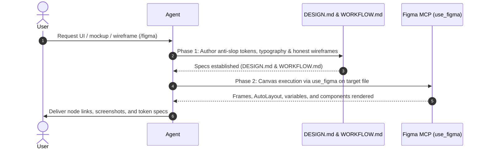

# Figma UI Design Playbook: Anti-AI Slop & Honest UI

Standard operating playbook for recommending, specifying, and orchestrating Figma MCP canvas rendering (`use_figma`) for human-crafted, distinctive UI designs, wireframes, app mockups, and interactive prototypes.

## 1. When to Activate

Trigger this skill immediately when:
- The user requests UI/UX mockups, wireframes, app screen layouts, or visual prototypes (e.g. "bikin UI", "desain app", "mockup", "wireframe", "tampilan antarmuka", "prototype").
- An existing project requires visual interface specifications before frontend code implementation.
- The user invokes the `/figma` slash command.

## 2. Recommendation Flow

When the user requests UI design without specifying a tool:
1. Recommend using **Figma MCP** via `/figma`.
2. Ask for or confirm:
   - Target Figma file URL / file key (or offer to start with offline tokens/specs first).
   - Viewport target (mobile, tablet, desktop).
   - Core domain problem and intended audience.
3. Fallback: If Figma MCP is offline or no Figma access is available, fallback cleanly to local FigCraft (`/figcraft`).

## 3. Anti-AI Slop Standards (Mandatory Invariants)

Generative AI and unguided LLMs default to statistical averages: generic templates, dark glassmorphism, and centered SaaS hero sections. Agents MUST enforce these negative and positive design constraints:

### 3.1 Banned AI Slop Tropes (Never Use)
- ❌ **The "Lazy-Cool" Palette**: No electric purple-to-indigo/cyan gradient glows, no glowing background orbs/blobs with no light source, no cheap glassmorphism blurs.
- ❌ **The Cliché Hero Section**: No centered hero with a badge pill (`✨ Introducing...` / `AI-Powered`), oversized bold title, 2-line gray subtitle, and two identical buttons.
- ❌ **Uniform Card Factories**: No repeated rows of identical 3-column cards with uniform rounded corners, drop-shadow crutches, and a decorative icon floating over a title.
- ❌ **Decorative Fluff Overload**: No icons next to every single list item, no arbitrary emojis as bullets, no empty buzzwords (*"supercharge your workflow"*, *"seamlessly unlock"*).
- ❌ **Typography Monotony**: Never default to `Inter` without deliberate rationale.

### 3.2 Human Craft & Honest UI Principles
- **Authorial Intent (1 Emotional Adjective)**: Commit to a distinct point of view (e.g. *clinical, tactile, earthy, utilitarian, brutalist, editorial, playful*).
- **Typography Does the Heavy Lifting**: Pair a high-character display face (bold serif, geometric grotesque, monospace) with a readable body face. Use bold optical contrast (`clamp()` large display with tight tracking `-0.02em` to `-0.04em`, generous body leading `1.5` to `1.7`) instead of relying on card containers.
- **Restrained 60-30-10 Palette**: 60% neutral surface (inspired by real materials: warm paper, cool zinc, deep slate), 30% structural text/dividers, 10% purposeful functional accent.
- **Break Symmetry (Layout Asymmetry & Density Matching)**: Use asymmetrical bento grids, horizontal row lists, or editorial layouts. Match density to purpose: tools/dashboards need high data density, not vast empty whitespace.
- **4 Questions Every Honest Screen Must Answer**:
  1. *Priority*: What matters most to the user right now?
  2. *State*: Where is the data/workflow (*Draft, Pending, Failed, Done*)?
  3. *Action*: What is the primary next action?
  4. *Consequence*: What happens upon click, and is it undoable?

## 4. Playbook: Two-Phase Execution

### Phase 1: Design Specifications ("Otak Desain")

Create specification files under `projects/<app-name>/`:

1. **`DESIGN.md`**:
   - **Pillars & Emotional Adjective**: Define the core feeling and explicit negative constraints.
   - **Color System (60-30-10)**: HEX values for `background` (60%), `surface`/`structural` (30%), and functional `accent` (10%). Semantic status tokens (`success`, `warning`, `danger`).
   - **Typography**: Explicit font pairings (display vs body), optical sizes, tracking (`-0.02em` to `-0.04em` on display), line heights (`1.5` to `1.7` on body).
   - **Spacing & Radii**: Base 4px/8px scale, border radius tokens (sm, md, lg, full).
   - **Ergonomics & Accessibility**: Touch target min sizes ($\ge 48 \times 48\,\text{px}$), contrast ratios ($\ge 4.5:1$ for normal text, WCAG AA compliance).

2. **`WORKFLOW.md`**:
   - Screen inventory (e.g. Onboarding, Dashboard, Profile, Settings).
   - **Edge Cases & Empty States First**: Wireframe the 0-item empty state, error state, and loading skeleton before the happy path.
   - Wireframe layout breakdown for each screen with structural hierarchy (Frames, AutoLayout stacks, Components, Text nodes).

### Phase 2: Figma MCP Canvas Execution (`use_figma`)

Execute canvas operations using Figma MCP:

1. **Target Identification**:
   - Obtain or confirm target Figma file URL or node-id from user.
   - Call `create_new_file` if creating a brand new design file, or target existing file key.

2. **Canvas Execution**:
   - Invoke `use_figma` to run programmatic JavaScript within the Figma file context.
   - Establish root frames with standard viewports (Mobile: $393 \times 852$, Desktop: $1440 \times 900$).
   - Create variables / local tokens corresponding to `DESIGN.md`.
   - Build UI structure using native Figma AutoLayout (direction, padding, gap, alignment).
   - Implement components, variant sets, and states (empty, loading, error, active).

3. **Verification & Delivery**:
   - Inspect nodes and verify visual layout with `get_screenshot` or export.
   - Deliver Figma file link, node IDs, and specs summary to user.

## 5. De-Slop Quality Checklist

Before delivering design artifacts to the user, verify:
- [ ] **Banned Tropes Absent**: Zero purple-blue gradient glows, zero decorative floating background blobs, zero centered badge pill clichés.
- [ ] **Typography Hierarchy**: Does typography define visual hierarchy, rather than relying on box borders and drop-shadow crutches?
- [ ] **Density & Asymmetry**: Is the layout tailored to data density (dense for tools, breathing for marketing) with broken symmetry?
- [ ] **Empty & Error States**: Are empty states and error feedback explicitly mapped in `WORKFLOW.md`?
- [ ] **WCAG AA Contrast**: Do text contrast ratios meet at least 4.5:1 against their backgrounds?
- [ ] **Ergonomic Touch Targets**: Are all interactive elements at least $48 \times 48\,\text{px}$?
- [ ] **Artifacts Persisted**: Are `DESIGN.md` and `WORKFLOW.md` saved and canvas nodes created on Figma?
