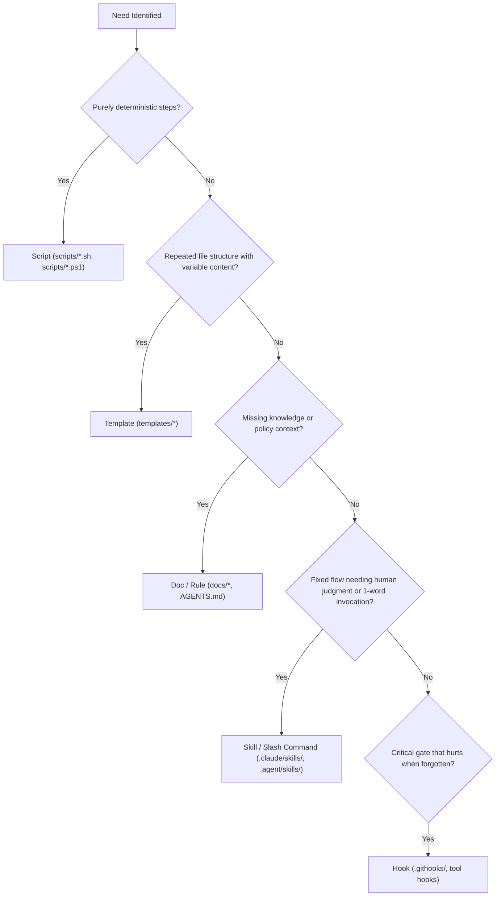

# Harness Builder Governance

Operational skill for identifying recurring developer tasks and constructing standardized, lightweight automation harnesses following Rule 12 of `genai-agentic-ops`.

## Core Principle: Recommend, Never Build Unasked

Agents must never construct unprompted scripts, templates, or hooks during task execution. A harness suggestion is offered as a single structured recommendation in the final task report. The user decides whether to approve, decline, or ignore it.

---

## Detection Triggers

Evaluate harness opportunities when any of the following triggers fire:

| ID | Trigger Condition | Practical Example |
|---|---|---|
| **a** | Task of the same kind is already recorded in the ops log or happened earlier in session ($\ge 2$ occurrences). | Second or third time formatting data dumps and copying to `dist/`. |
| **b** | User explicitly signals repetition with phrases like *"every time"*, *"usually"*, *"always"*, *"each week"*. | *"Every week we check for expired trial accounts."* |
| **c** | Executed a multi-step deterministic sequence by hand. | Executed 5 consecutive commands to generate certificates, copy them, and restart local ingress. |
| **d** | A recurring mistake happened that automated tooling could catch. | Secret pattern nearly staged twice; missing migration check. |

If no trigger clearly applies, do not suggest a harness.

---

## Hierarchy of Harness Types (Lightest First)

Always select the lightest harness that satisfies the requirement:



- **Script**: Deterministic commands, zero human judgment required.
- **Template**: Scaffolding repeated file formats (markdown reports, config schemas).
- **Doc / Rule**: Codifying guidelines, architectures, or checklists.
- **Skill / Slash Command**: Interactive workflows requiring LLM judgment or reasoning steps.
- **Hook**: Machine-enforced invariants (pre-commit checks, guard hooks).

---

## When NOT to Suggest a Harness

Do NOT recommend a harness if:
1. The task is a one-off action with no reasonable expectation of recurrence.
2. The procedure is volatile or changes significantly between iterations.
3. Building and testing cost outweighs the cumulative savings over the next 5 uses.
4. An existing harness already covers the workflow (search `scripts/`, commands, and docs first).
5. The user previously declined this suggestion (check `docs/HARNESS_DECLINED.md` before recommending).

---

## Standard Suggestion Format

Include at most **one** suggestion line in the closing response:

```markdown
Harness suggestion: <what repeats, in one line> | Type: <script|template|doc|skill|hook> | Saves: <est. time/tokens per use> | Effort: <est. build time> | Where: <proposed target path>
```

### Example
```markdown
Harness suggestion: manual database schema dump & diff performed twice | Type: script | Saves: ~5 min and ~2k tokens per run | Effort: ~15 min incl. test | Where: scripts/db-diff.sh
```

---

## Response Lifecycle

- **User Approves**: Treat building the harness as a new task. Present a concise plan (Rule 1), log in `docs/CURRENT_OPS.md` (Rule 3), execute, verify with automated tests/dry run (Rule 5), and document usage in the file header.
- **User Declines**: Append one line to `docs/HARNESS_DECLINED.md` (never suggest again unless requested):
  ```markdown
  YYYY-MM-DD | <harness description> | <reason user declined>
  ```
- **User Ignores**: Do not repeat the suggestion in the same session.
