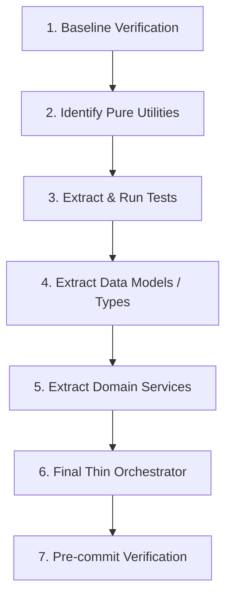

# Modular Code & Anti-Monolith Governance

A practical skill for AI agents and developers to design, structure, and refactor source code into clean, modular units. Prevents runaway file bloat and monolithic designs before they trigger commit rejection.

## Core Heuristics & Thresholds

| Metric | Threshold | Meaning & Action |
|---|---|---|
| Target Line Count | **< 300 lines** | Sweet spot for readability, testability, and token efficiency. Files should aim for this range. |
| Warning Threshold | **300 – 499 lines** | Approaching boundary. Proactively plan file splitting during new feature additions. |
| Hard Rejection Cap | **500 lines** | Anti-monolith limit enforced by `precommit-check` (Rule 5 & 10). Staging fails unless decomposed or explicitly overridden with `ALLOW_LARGE_SOURCE=1`. |

### Golden Rules
1. **Single Responsibility**: Each file should have one distinct reason to change (e.g. data access, routing, domain logic, styling).
2. **Decompose Early**: Split as soon as a file reaches ~300 lines. Refactoring a 300-line file is trivial; untangling an 800-line monster is perilous.
3. **Keep Tests Green**: Extract one piece at a time and verify tests after each step.

---

## Playbook 1: Web Frontend (HTML / CSS / JS)

Monolithic single-file web components or pages that bundle HTML markup, CSS styling, and JavaScript logic quickly breach the 500-line limit and become impossible to maintain.

### Separation of Concerns Architecture

```
frontend/
├── index.html              # Clean semantic skeleton (< 150 lines)
├── styles/
│   ├── base.css            # CSS reset, variables, typography
│   ├── layout.css          # Grid, flex containers, navbars
│   └── components/         # Modular CSS per component
│       ├── cards.css
│       └── modal.css
└── js/
    ├── api.js              # Fetch requests, endpoints, error handling
    ├── state.js            # Reactive stores or state management
    ├── components/         # Self-contained DOM controllers
    │   └── modal.js
    └── app.js              # Application bootstrapping (< 80 lines)
```

### Extraction Workflow
1. **Extract Inline Styles (`<style>` → `.css`)**:
   - Move style blocks into semantic CSS files (`base.css`, `layout.css`, `components/*.css`).
   - Link via `<link rel="stylesheet" href="...">` in HTML `<head>`.
2. **Extract Inline Scripts (`<script>` → `.js`)**:
   - Extract logic into ES modules (`type="module"`).
   - Separate API/fetch calls into `api.js`.
   - Separate state mutation into `state.js`.
   - Keep views/event handlers in dedicated UI modules.
3. **Decompose Large HTML Documents**:
   - In template-based frameworks (Django, Jinja, Go templates, Vue/Svelte/React): split large templates into semantic partials (`_header.html`, `_sidebar.html`, `_card.html`).
   - In static HTML: create reusable Web Components or template fragments loaded dynamically.

---

## Playbook 2: Backend Architecture (Go, Python, TypeScript)

Backend files grow rapidly when HTTP handling, business calculations, SQL queries, and serialization types live in a single file.

### Layered Separation Pattern

```
backend/
├── models/ (or types/)     # Data structs, entities, serialization schemas
│   └── user.py
├── repositories/ (or db/)  # Database queries, ORM/SQL operations, cache
│   └── user_repo.py
├── services/               # Core business logic, validation, third-party calls
│   └── user_service.py
└── handlers/ (or routes/)  # HTTP route definitions, request parsing, status codes
    └── user_handler.py
```

### Language Examples

#### Python
- **Bad**: `routes.py` with 600 lines defining DB models, SQL queries, FastAPI routes, and Stripe payment logic.
- **Good**:
  - `models/user.py`: Pydantic models / dataclasses.
  - `services/billing.py`: Payment calculation logic.
  - `repositories/user_repo.py`: SQLAlchemy session operations.
  - `routers/user_router.py`: FastAPI endpoints delegating to service.

#### Go
- **Bad**: `server.go` with 800 lines containing structs, SQL query methods, and HTTP handler functions.
- **Good**:
  - `pkg/user/model.go`: Domain structs.
  - `pkg/user/repository.go`: Database interface and SQL implementation.
  - `pkg/user/service.go`: Business rules.
  - `pkg/user/handler.go`: `http.HandlerFunc` endpoints.

#### TypeScript / Node.js
- **Bad**: `src/index.ts` containing Express routes, schema validation, Prisma queries, and utility helper functions.
- **Good**:
  - `src/types/`: TypeScript interfaces and Zod schemas.
  - `src/controllers/`: Express request/response coordinators.
  - `src/services/`: Core business functions.
  - `src/db/`: Prisma client wrappers and repository methods.

---

## Playbook 3: Refactoring Existing Monoliths

When a legacy file exceeds 500 lines, refactor it systematically using an incremental extraction workflow. Never attempt a blind complete rewrite.

### Step-by-Step Extraction Workflow



1. **Step 1: Baseline Verification**
   - Run the project test suite (`pytest`, `go test`, `npm test`, etc.) to confirm all tests pass before making any changes.
   - Record test pass counts and commit snapshot if necessary.
2. **Step 2: Identify and Extract Pure Utilities**
   - Find self-contained helper functions (formatting, date calculations, parsing) with no dependencies on file-global state.
   - Move them to `utils/` or `helpers/`.
   - Re-import and run the test suite.
3. **Step 3: Extract Data Models and Types**
   - Move struct definitions, classes, interfaces, or type annotations into dedicated model files.
   - Update imports across the codebase.
   - Run tests to confirm zero regressions.
4. **Step 4: Extract Domain Services / Storage Layers**
   - Move DB queries or external API logic into a service or repository module.
   - Pass dependencies explicitly (dependency injection or modular imports) instead of relying on globals.
   - Run tests.
5. **Step 5: Verify File Size Under Limits**
   - Run `git status` and count lines in modified files:
     `wc -l <modified files>`
   - Verify every modified file is well under the 500-line hard cap (target < 300 lines).
6. **Step 6: Pre-Commit Check**
   - Run `precommit-check` (or `git add` and dry run) to guarantee the anti-monolith gate passes without error.
