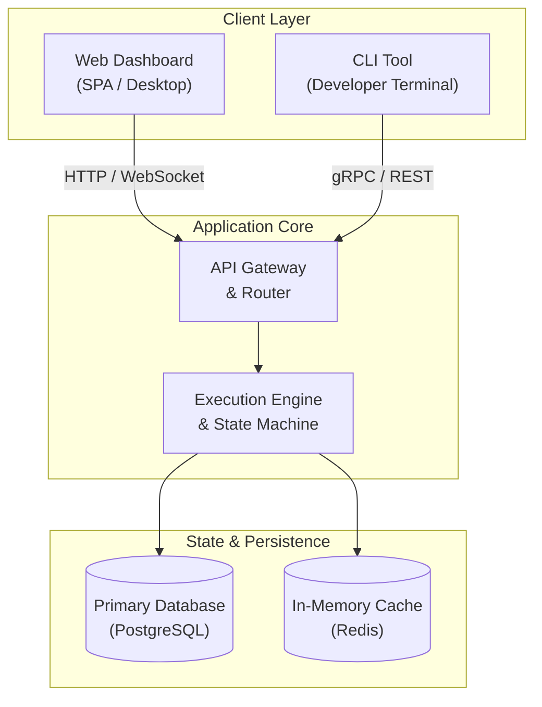

# README Architect & Documentation Governance

A standardized skill and architectural blueprint for crafting high-impact, professional repository documentation. Ensures repository landing pages convey immediate technical clarity, adhere to the 3-second/3-minute scanning rule, and prevent documentation monoliths by decomposing operational details into dedicated directories.

---

## The 3-Second, 30-Second, 3-Minute Scan Rule

Every technical README must serve three distinct reader journeys simultaneously:

```
┌─────────────────────────────────────────────────────────────┐
│ 3-Second Scan: Immediate Context                           │
│ • Centered Hero, Logo, Project Title & Subtitle             │
│ • Uniform Flat-Square Badges (Build, Release, License)      │
│ • Core Value Proposition & Quick Jump Anchor Bar            │
└──────────────────────────────┬──────────────────────────────┘
                               │
┌──────────────────────────────▼──────────────────────────────┐
│ 30-Second Scan: Architectural & Functional Comprehension    │
│ • Problem-Solution Framing Blockquote (> Built for...)      │
│ • High-Level Mermaid Architecture Diagram (Swimlanes)       │
│ • 2-Column Feature Matrix (Domain vs Operations/UX)         │
│ • Structured Tech Stack Matrix (Layer | Tech | Purpose)     │
└──────────────────────────────┬──────────────────────────────┘
                               │
┌──────────────────────────────▼──────────────────────────────┐
│ 3-Minute Scan: Operational Onboarding & Deep Dives          │
│ • Copy-Pasteable Quick Start Blocks (< 5 Steps)             │
│ • Out-of-Process / Service Lifecycle Runbook                │
│ • Self-Service Emergency & Troubleshooting Table            │
│ • Known Gaps & Design Limitations Transparency              │
│ • Modular Documentation Index (Pointers to docs/)           │
└─────────────────────────────────────────────────────────────┘
```

1. **3-Second Scan (The Glance)**: A developer or stakeholder immediately recognizes what the project is, whether it is actively maintained, what license applies, and its 1-sentence value proposition.
2. **30-Second Scan (The Evaluation)**: The reader grasps the architectural topology, understands what problems it solves, evaluates the feature split, and verifies technical compatibility with their stack.
3. **3-Minute Scan (The Implementation)**: An engineer clones the repository, configures the environment, runs the project without hidden steps, handles edge-case troubleshooting, and locates deep technical specifications.

---

## Anti-Monolith Documentation Rule

Just like source code, documentation suffers from monolithic rot. A root `README.md` that exceeds 500 lines degrades readability, becomes difficult to scan, and discourages contributions.

| Metric | Threshold | Governance Action |
|---|---|---|
| Target Line Count | **< 300 lines** | Ideal target. Delivers full scanning value while remaining concise. |
| Maximum Allowed Cap | **350 lines** | Hard ceiling for root `README.md`. Any content beyond this must be decomposed into `docs/`. |
| Deep Technical Guides | **`docs/*.md`** | Detailed API references, database schemas, RFCs, migration guides, and deep runbooks live in `docs/`. |

### Decomposition Strategy

When a section expands beyond high-level orientation, extract it into a dedicated document in `docs/`:

- **Detailed Architecture & Threat Models** → `docs/architecture.md`
- **Full API Specification & Endpoints** → `docs/api-reference.md`
- **Database Schema & Migration Workflows** → `docs/database.md`
- **Deployment & Production Runbooks** → `docs/deployment.md`
- **Detailed Troubleshooting & FAQs** → `docs/troubleshooting.md`

---

## Golden Blueprint Core Components

### 1. Hero Area (`<div align="center">`)
- Centered layout containing an optional SVG/PNG logo.
- Clear `# Title` and a punchy, descriptive tagline.
- Uniform badges rendered with `style=flat-square` (e.g. CI/CD status, latest release, license, runtime version). Avoid mismatched badge styles.
- Navigation anchor bar linking directly to key sections:
  `[Architecture](#architecture) • [Features](#features) • [Tech Stack](#tech-stack) • [Quick Start](#quick-start) • [Operations](#operations) • [Docs](#documentation)`

### 2. Problem-Solution Framing
- A dedicated blockquote immediately following the hero:
  ```markdown
  > **Built for [Target Audience]** facing [Specific Core Problem]. [Project Name] provides [Unique Architectural Approach] to deliver [Measurable Outcome] without [Common Pain Point].
  ```
- Sets expectations instantly before diving into implementation details.

### 3. Visual Architecture (Mermaid Flowchart)
- Use standard `flowchart TD` or `flowchart LR`.
- Divide components into logical subgraphs or swimlanes (e.g., Client Layer, Gateway/API, Background Services, Data Layer).
- Add line breaks (`<br/>`) inside node text blocks to prevent wide, unwieldy boxes on mobile and narrow displays.
- Quote nodes containing special characters or punctuation.

### 4. Two-Column Feature Table
- Standard Markdown tables collapse into single long vertical scrolls. Use a clean HTML two-column table to separate domain features from operational/developer capabilities:
  ```html
  <table>
    <tr>
      <td width="50%" valign="top">
        <h4>Domain & Core Capabilities</h4>
        <ul>
          <li><strong>Feature A</strong>: Capability detail.</li>
        </ul>
      </td>
      <td width="50%" valign="top">
        <h4>Operations & Developer Experience</h4>
        <ul>
          <li><strong>Zero-Config Dev</strong>: Hot-reload workflows.</li>
        </ul>
      </td>
    </tr>
  </table>
  ```

### 5. Tech Stack Matrix
- Summarizes technical choices in a 3-column table:
  ```markdown
  | Layer | Technology | Purpose |
  |---|---|---|
  | Frontend / UI | Svelte / TailwindCSS | Reactive dashboard interface |
  | Backend Core | Go (Echo) | High-throughput API gateway |
  | Persistence | PostgreSQL + Redis | Relational storage & cache layer |
  ```

### 6. Action-Oriented Quick Start
- Provide explicit prerequisites (runtime versions, CLI tools).
- Use sequential, copy-paste ready shell blocks with inline comments.
- Reference `.env.example` and provide exact configuration setup steps.
- Target under 5 commands from clone to running instance.

### 7. Out-of-Process / Operations Guide
- Explicit guidance for services running outside containers, daemons, background schedulers, systemd units, or local sidecars.
- Covers starting, stopping, health checking, and viewing daemon logs.

### 8. Troubleshooting & Self-Service Emergency Access
- Provide immediate remedies for the most frequent failures:
  - Database connectivity or migration locks.
  - Port conflicts.
  - Expired tokens or forgotten local administrative credentials.
  - Cache poisoning or state desynchronization.

### 9. Known Gaps & Limitations Transparency
- Proactively document intentional constraints, unsupported edge cases, and in-flight migrations.
- Builds engineering trust and prevents wasted debugging cycles.

### 10. Modular Documentation Index Table
- A structured index linking to deep technical documents in `docs/`:
  ```markdown
  | Document | Purpose | Audience |
  |---|---|---|
  | [Architecture](docs/architecture.md) | Component topologies, data flow, security | Architects & Core Devs |
  | [Operations Runbook](docs/operations.md) | Production deployment, backup & recovery | SRE & Ops |
  ```

---

## Full Copy-Paste Blueprint Template

Use this comprehensive template when creating or standardizing a repository README:

````markdown
<div align="center">

# Project Name

**A concise, punchy tagline describing the core technical achievement.**

[](https://github.com/username/repo/actions)
[](https://github.com/username/repo/releases)
[](LICENSE)
[](#tech-stack)

[Architecture](#architecture) • [Features](#features) • [Tech Stack](#tech-stack) • [Quick Start](#quick-start) • [Operations](#operations) • [Documentation](#documentation)

</div>

---

> **Built for engineering teams** who need robust, auditable automation. Project Name replaces fragile ad-hoc scripts with a resilient, host-agnostic runtime that enforces strict safety boundaries and zero-dependency deployments.

---

## Architecture



---

## Features

<table>
  <tr>
    <td width="50%" valign="top">
      <h4>Core Capabilities</h4>
      <ul>
        <li><strong>Deterministic Workflows</strong>: State machine with transactional recovery.</li>
        <li><strong>Real-time Telemetry</strong>: Low-latency metric aggregation and event streaming.</li>
        <li><strong>Modular Extensibility</strong>: Pluggable provider architecture.</li>
      </ul>
    </td>
    <td width="50%" valign="top">
      <h4>Operations & Reliability</h4>
      <ul>
        <li><strong>Self-Healing Workers</strong>: Automatic backoff and crash isolation.</li>
        <li><strong>Zero-Downtime Migration</strong>: Non-blocking schema evolution.</li>
        <li><strong>Audit Logging</strong>: Append-only ledger for all privileged actions.</li>
      </ul>
    </td>
  </tr>
</table>

---

## Tech Stack

| Layer | Technology | Purpose |
|---|---|---|
| **Runtime & Core** | Go 1.23+ / Python 3.11+ | High-performance execution runtime |
| **API & Routing** | Echo / FastAPI | Structured RESTful & streaming endpoints |
| **Persistence** | PostgreSQL 16 | Relational data integrity & ACID guarantees |
| **Caching & PubSub** | Redis 7 | Distributed locking and ephemeral queues |
| **Packaging** | Docker / Compose | Consistent development & containerized deployments |

---

## Quick Start

### Prerequisites
- Docker Engine 24+ & Docker Compose v2
- Node.js 20+ (for local frontend development)
- Git 2.40+

### Setup in 4 Steps

```bash
# 1. Clone repository and navigate to root
git clone https://github.com/username/repo.git
cd repo

# 2. Copy environment configuration
cp .env.example .env

# 3. Start core infrastructure and background services
docker compose up -d

# 4. Verify service health
curl http://localhost:8080/health
```

The application is now accessible at `http://localhost:8080`.

---

## Operations & Service Lifecycle

When running services outside containers (e.g. native host daemons or development workers):

```bash
# Start background worker daemon
./bin/worker --config config.yaml > logs/worker.log 2>&1 &

# Inspect running process & status
ps aux | grep "[b]in/worker"

# Graceful termination
kill -SIGTERM $(cat run/worker.pid)
```

---

## Troubleshooting & Self-Service

| Symptom | Probable Cause | Immediate Remediation |
|---|---|---|
| `connection refused :8080` | Port collision or container offline | Run `docker compose ps` and verify port bindings in `.env`. |
| `migration lock timeout` | Previous migration process killed | Execute `./scripts/db-unlock.sh` and re-run migrations. |
| `auth token expired` | Stale session cache in Redis | Run `redis-cli FLUSHDB` or refresh credentials via CLI. |

---

## Known Gaps & Limitations

- **Horizontal Scaling**: Cluster coordination currently relies on Redis locks; distributed Raft consensus is planned for v2.0.
- **WebSocket Reconnection**: Edge disconnects trigger full state polling rather than incremental delta replays.

---

## Documentation

For comprehensive technical specifications, refer to the modular documentation guides:

| Document | Purpose | Target Audience |
|---|---|---|
| [System Architecture](docs/architecture.md) | Deep dive into component topologies and state models | Architects & Core Contributors |
| [API Reference](docs/api-reference.md) | Complete OpenAPI / REST specification & examples | Integrators & Frontend Developers |
| [Deployment Runbook](docs/deployment.md) | Production infrastructure, secrets, and TLS setup | DevOps & Site Reliability Engineers |
| [Security Governance](docs/security.md) | Threat matrix, auth token lifecycle, and audit policy | Security Engineers & Auditors |

---

## License

Distributed under the [MIT License](LICENSE).
````
