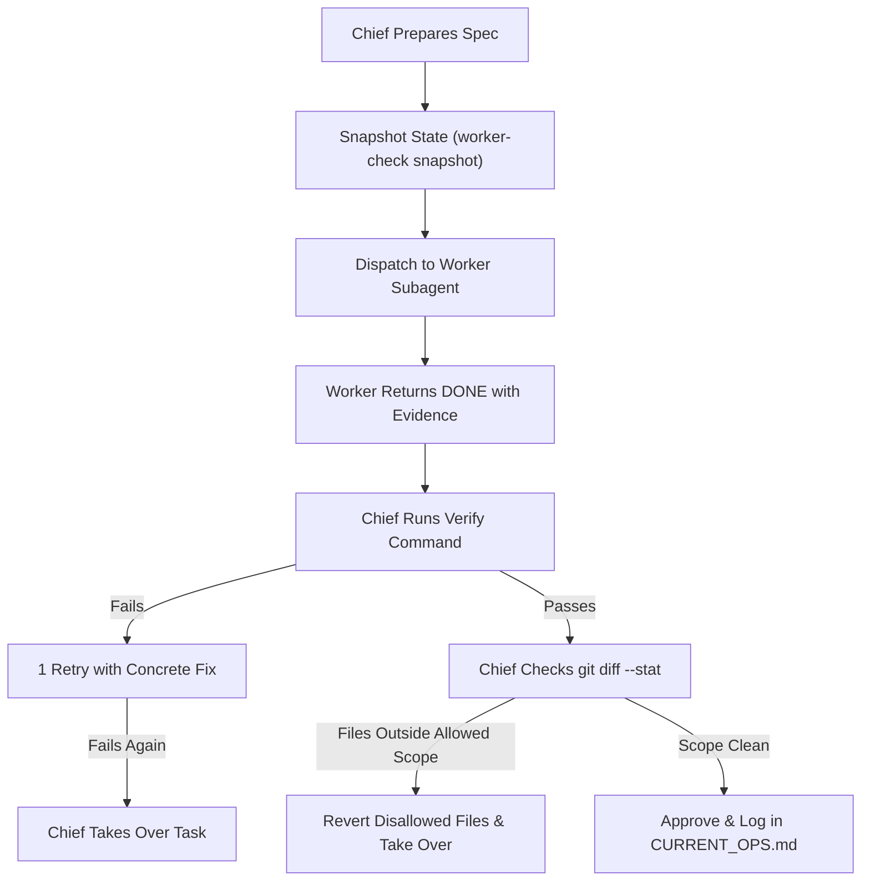

# Worker Delegation Governance (Chief & Workers)

Operational playbook for delegating compute-heavy or mechanical coding tasks from a primary session ("Chief") to specialized background subagents ("Workers") following Rule 2 of `genai-agentic-ops`.

## Roles & Responsibilities

| Role | Primary Functions | Constraints |
|---|---|---|
| **Chief** | User conversation, planning, writing worker specs, cost assessment, independent verification, closeout reporting. | Always in charge; never delegates judgment or small fixes. |
| **Worker** | Autonomous execution of bounded tasks inside the granted file scope; returns structured evidence. | Never approves own work; never edits outside `Allowed Files`; returns `DONE` or `BLOCKED`. |

---

## When to Delegate (Thresholds & Triggers)

### Rule 0: Never Delegate
Never delegate:
- Architectural / design decisions.
- Small fixes (about 15 lines or fewer).
- Debugging that requires interactive judgment or exploration.
- Code or PR reviews.
- Direct user questions.

### Cost Thresholds
When usage metrics are available (e.g., token usage or session percentage):
- **Standard Threshold**: Delegate if estimated task cost exceeds **5%** of the 5-hour usage quota.
- **Tight Quota (Tier 2)**: If current 5-hour quota is $\ge 70\%$ used or weekly limit is $\ge 80\%$, lower delegation threshold to **2%**.

### Size as a Proxy (When Quota Metrics Unavailable)
Delegate if any of the following is true:
1. Mechanical edits across $\ge 10$ files (e.g. rename, API migration, pattern replacement).
2. Long-running or verbose test/build loops.
3. Wide repository read sweeps where only a synthesized summary is needed.
4. Batch execution expected to run $> 2$ minutes.
5. Bulk asset generation (multiple boilerplate modules, repetitive test fixtures).

---

## The Delegation Specification

The Chief MUST format every delegation prompt with an explicit, unambiguous specification:

```markdown
Goal: <Single clear, actionable sentence describing the target state>
Allowed Files: <Explicit list of relative file paths or globs; worker MUST NOT touch anything else>
Verify Command: <Single automated command returning exit 0 on success, e.g. 'pytest tests/unit/'>
Evidence Required: <Short diff summary and verify command output>
Rules: Follow RULES.md; do not approve your own work; report DONE or BLOCKED with evidence
```

---

## Chief Verification & Approval Lifecycle



1. **Snapshot Baseline**:
   - Before dispatching, snapshot current state if using `worker-check`:
     `scripts/agentic-ops/worker-check snapshot --out task.snap`
2. **Execute Worker**:
   - Worker runs in isolation and submits results back via message.
3. **Independent Verification**:
   - Chief re-runs the verify command locally. Never accept the worker's word alone.
   - Run `git diff --stat` (or `worker-check check --allow '...' --verify '...' --since task.snap`).
   - Confirm zero edits occurred outside `Allowed Files` and no sensitive files (`.env`, hooks, credentials) were altered.
4. **Retry Policy**:
   - If tests fail or scope is exceeded: grant **at most one** retry with specific, actionable instructions.
   - If the second attempt fails: chief terminates the worker, reverts disallowed edits, and completes the work directly.
5. **Closeout**:
   - Record the operation in `docs/CURRENT_OPS.md` (e.g. `subagent-<purpose>-<n>`).
   - Summarize findings and result cleanly to the user.
